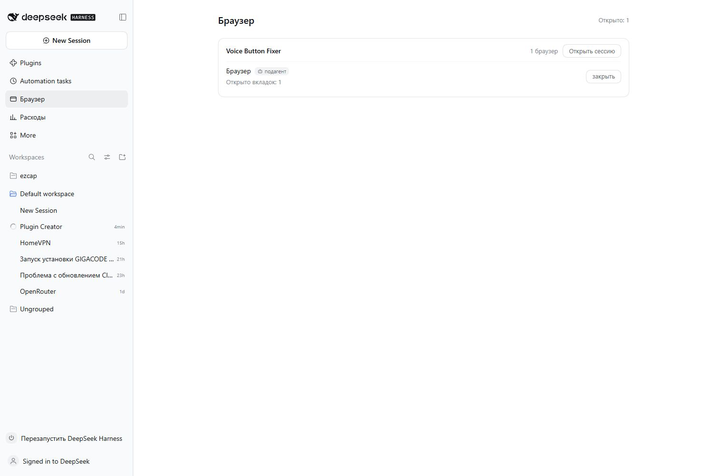
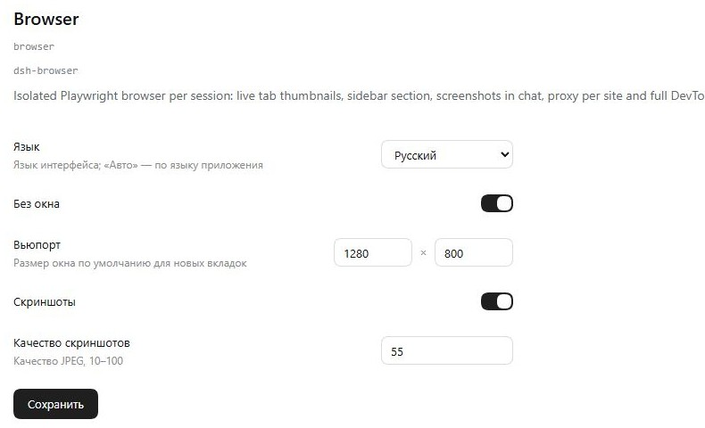

# dsh-browser

DSH plugin: an isolated Playwright browser per session — live tab thumbnails in the composer dock,
a **Browser** section in the sidebar, a per-site proxy and DevTools-grade tooling for agents.
16 tools, 33 `browser_run` commands (including `list`/`help` and the network presets), a settings
form, and a regression suite.

Real Chromium (Playwright) for every DSH session: live thumbnails in the dock, a **Browser**
section in the sidebar, a per-site proxy and full DevTools access.

## Screenshots





## Installation

One command — it adds the dependency from GitHub and runs the package manager:

```bash
dsh plugin --profile desktop add @machine202502/dsh-browser
```

Then restart DSH: the **Browser** section appears in the sidebar and the browser card in the dock.

Useful variants:

```bash
node install.mjs --profile desktop --dry-run   # show what will change
node install.mjs --home /path/to/.dsh          # a different DSH directory
node install.mjs --uninstall                   # remove the plugin
```

Chromium is installed separately; `playwright-core` does not pull it in:

```bash
npx playwright install chromium
```

Manual installation (if pnpm is unavailable) — in `~/.dsh/profiles/desktop/package.json`:

```json
{
  "dependencies": { "@machine202502/dsh-browser": "^0.1.1" },
  "dsh": { "profile": { "bundles": ["…", "@machine202502/dsh-browser"] } }
}
```

Check: `npm test` in the plugin directory (requires the `node tests/qa-page.mjs` page).

## What it gives

- **A browser per agent.** A separate process, a separate temporary profile, its own tabs.
  A subagent gets its own browser and cannot see anyone else's.
- **Contexts.** `ctx1`, `ctx2`, … — isolated cookies and storage inside one browser,
  so two clients can be tested against one server.
- **Live frames.** The dock card shows tab thumbnails and a virtual pointer;
  after actions (`open`, `navigate`, `click`, `resize`, `drag`) a frame is posted to the chat.
- **Browser section in the sidebar.** A list of open browsers grouped by session:
  session name, number of tabs, jumping to the session, closing an individual browser.
- **Per-site proxy.** A built-in routing proxy on `127.0.0.1:49222`: it looks at the host
  of every connection and routes only the listed sites through Hiddify, everything else goes direct.
  Chromium 156 ignores PAC (both `--proxy-pac-url` and `chrome.proxy` from an extension), so the
  decision is made outside the browser. The site list and the proxy address persist across restarts
  in the data directory: `%LOCALAPPDATA%\dsh-browser` (Windows), `~/.local/share/dsh-browser` (Linux),
  `~/Library/Application Support/dsh-browser` (macOS).
- **Debugging.** Network, console, cookies, storage, IndexedDB, coverage, accessibility snapshot, Lighthouse.

## Tools

| Tool | Purpose |
|---|---|
| `browser_open` | open a tab (optionally in a specific `ctx`) |
| `browser_navigate` | navigate to a URL |
| `browser_click` | click a CSS selector (not blocked by a dialog) |
| `browser_fill` | fill a field |
| `browser_hover` / `browser_drag` | pointer and drag (within the viewport) |
| `browser_resize` | viewport size |
| `browser_text` | page text |
| `browser_tabs` | tab list |
| `browser_close` | close a tab (the last one shuts the browser down) |
| `browser_cdp` | raw Chrome DevTools Protocol call |
| `browser_run` | command dispatcher (see below) |
| `browser_proxy_enable` / `browser_proxy_disable` / `browser_proxy_status` / `browser_proxy_list` | proxy |

All tools accept `timeout` (ms). The default is 10–45 s depending on the operation.

## `browser_run` commands

`browser_run({ command: "list" })` — the catalogue; `{ command: "help", args: { name: "network" } }` — details.

| Command | What it does |
|---|---|
| `console` | `console.*` and page errors, including asynchronous ones |
| `network` | requests with codes, types and errors |
| `cookies` | get / set / clear |
| `storage` | `localStorage` / `sessionStorage` |
| `idb` | IndexedDB: databases, stores, rows |
| `eval` | run JS, return the value |
| `dom` | html / text / attrs / styles / count of an element |
| `snapshot` | accessibility tree (role and name) |
| `keyboard` | `press`, `type`, `down`, `up` |
| `dialog` | `accept` / `dismiss` / text for `prompt` |
| `emulate` | network, color scheme, CPU, time zone, geolocation |
| `metrics` | page performance metrics |
| `perf` | record the main thread for N seconds: where the time went |
| `slow3g` / `fast3g` / `offline` / `off` | network presets in one word |
| `trace` | record a Playwright trace |
| `coverage` | JS coverage between start and stop |
| `downloads` | files downloaded by the browser |
| `lighthouse` | audit: scores, metrics, failed checks |
| `report` | parse a saved report: list or a single audit |
| `css` | matched rules for an element: selectors, properties, media queries, fonts |
| `assets` | page resources by type, `download: true` — save to disk |
| `html` | the full document HTML into a file |
| `screenshot` | page or element snapshot into a file (opened with `read_image`) |
| `diff` | pixel comparison of two screenshots |
| `ws` | WebSocket connections and frames in both directions |
| `wait` | wait for a selector or text |
| `ctx` | tabs by context |
| `cdp` | an arbitrary protocol method |

## Configuration

```yaml
- id: browser
  name: 'dsh-browser'
  config:
    language: ru
    headless: true
    bridgePort: 49221
    idleTimeoutMs: 900000
    viewport: { width: 1280, height: 800 }
    proxy:
      server: 127.0.0.1:10901
    shots:
      enabled: true
      on: [open, navigate, click, resize, drag]
      quality: 55
      minIntervalMs: 1500
```

## Languages

Interface languages: **Russian**, **English**, **Chinese**.

The `language` setting is used when it is `ru` / `en` / `zh`; `auto` follows the application
language (`document.documentElement.lang`, then `navigator.language`): `ru*` → `ru`,
`zh*` → `zh`, otherwise `en`. The default is `ru`.

The language is changed in **Plugins → Browser → Configure** — the settings form offers
Русский / English / 中文 / Авто — and applies immediately, without restarting DSH.
The value is stored in `%LOCALAPPDATA%\dsh-browser\settings.json`.

## Platforms

The plugin makes no platform-specific calls: Chromium is located through the Playwright paths for
Windows, Linux and macOS (or set via `DSH_BROWSER_EXE`), the process watchdog talks to the browser
over CDP rather than through `taskkill` or `kill`, and paths are built with `node:path`.

```
Windows   %LOCALAPPDATA%\ms-playwright\chromium-*/chrome-win64/chrome.exe
Linux     ~/.cache/ms-playwright/chromium-*/chrome-linux/chrome
macOS     ~/Library/Caches/ms-playwright/chromium-*/chrome-mac*/Chromium.app/Contents/MacOS/Chromium
```

## Architecture

- **Host** (`index.js`) keeps one manager per agent, registers the tools and the `127.0.0.1:49221`
  bridge for the client part.
- **Manager** (`src/browser-manager.js`) launches Chromium through `launchPersistentContext`
  in a temporary profile that is deleted when the browser closes.
- **Bridge** (`src/bridge.js`) serves tabs, frames and proxy state to the client.
- **Client** (`client.js`) draws the dock card, the sidebar section and the tool-row view
  with a frame thumbnail.
- **Proxy** (`src/routing-proxy.js`) routes connections according to rules from the bridge.

## Limitations

- **`lighthouse`** requires the package to be installed; without it the command returns a clear
  error and the rest of the plugin keeps working.

## Requirements

- Chromium from Playwright (`ms-playwright`); the path can be set via `DSH_BROWSER_EXE`.
- `lighthouse` — an optional dependency: the `lighthouse` command returns a clear error
  if the package is not installed. The rest of the plugin works without it.

## Process termination

The browser does not outlive the host. Besides the regular shutdown on `dispose`, a separate
watchdog (`src/watchdog.mjs`) runs next to every browser: if the DSH process disappears, it closes
Chromium through its own DevTools endpoint. The platform does not matter — it is Node and CDP, no `taskkill`.
